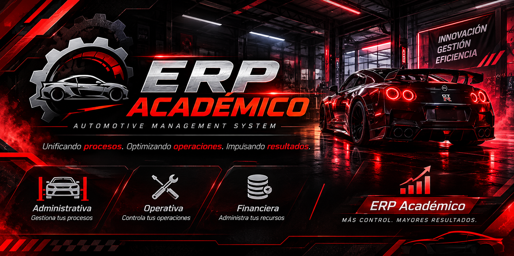

# 🚗 ERP Académico

  

  **Unificando procesos. Optimizando operaciones. Impulsando resultados.**

  
  
  

---

## 📌 Descripción

ERP Académico es un sistema de planificación de recursos empresariales (ERP) orientado a integrar, centralizar y automatizar los procesos administrativos, operativos y financieros de talleres automotrices.

El proyecto está diseñado inicialmente para una empresa del sector automotriz, con el propósito de optimizar la gestión de sus recursos, mejorar la organización de sus actividades y facilitar la toma de decisiones.

Además, contempla una estructura escalable que permitirá adaptarse posteriormente a las necesidades de otros talleres.

## 🎯 Objetivos

- **Automatización:** Optimizar los procesos empresariales.
- **Centralización:** Integrar la información en una sola plataforma.
- **Organización:** Mejorar la gestión de los recursos.
- **Control:** Facilitar el seguimiento de las operaciones.
- **Escalabilidad:** Permitir futuras ampliaciones del sistema.

## 🧩 Módulos principales

| Módulo | Descripción |
|:---|:---|
| 🏢 **Administrativo** | Gestión de procesos y recursos administrativos. |
| 🔧 **Operativo** | Organización y control de las actividades del taller. |
| 💰 **Financiero** | Administración y seguimiento de los procesos financieros. |

## 🛠️ Tecnologías

Las tecnologías y herramientas utilizadas se documentarán conforme avance el desarrollo del proyecto.

## 🚧 Estado del proyecto

**🟠 En desarrollo**

Actualmente, el proyecto se encuentra en fase de planificación y desarrollo de sus componentes principales.

## 🔮 Visión

Construir una solución ERP modular y escalable que permita mejorar la eficiencia empresarial, centralizar la información y adaptarse a las necesidades del sector automotriz.

---

  **ERP ACADÉMICO**
   
  <em>Automotive Management System</em>
    
  Desarrollado con dedicación 🐱

